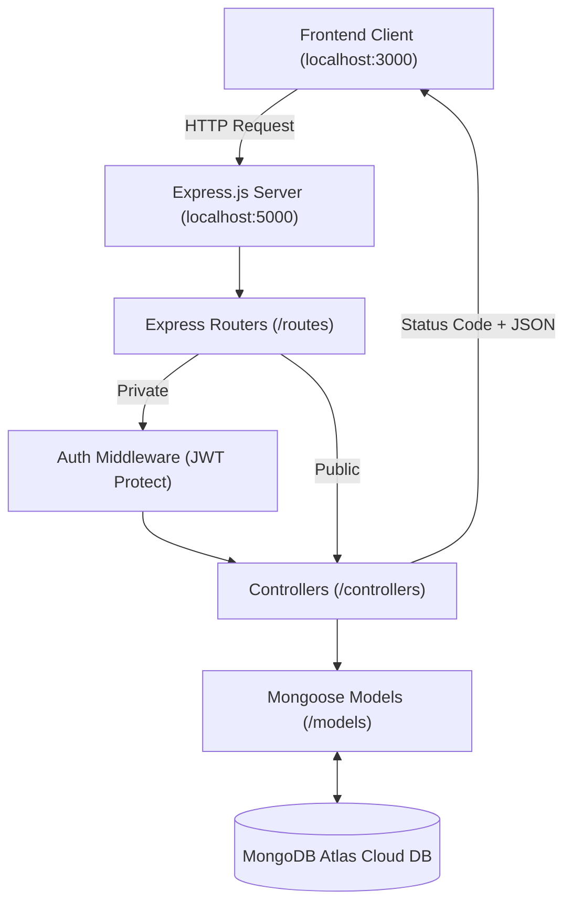

# CampusBites — College Evaluation & Viva Guide

This guide prepares you for your college evaluation and viva examination with clear, beginner-friendly explanations.

---

## 1. Core Technical Concepts

### Node.js
- **What is Node.js?** A cross-platform JavaScript runtime environment that executes JavaScript code outside a web browser, on the server.
- **Why does CampusBites need Node.js?** To run our backend server—listening for HTTP requests, interacting with MongoDB Atlas, calculating order bills, and issuing authentication tokens.

### Express.js
- **What is Express.js?** A minimalist, fast web framework for Node.js used to build REST APIs.
- **What does `const app = express()` do?** Instantiates the Express application server.
- **What does `app.use()` do?** Mounts middleware functions in the request processing pipeline.
- **What are routes?** Definitions mapping HTTP method + URL endpoint to a controller handler function.
- **What is middleware?** Functions with access to `req`, `res`, and `next()`. They execute logic before route handlers (e.g. JSON body parsing, CORS, JWT authentication, and error handling).

### MongoDB Atlas & Mongoose
- **What is MongoDB Atlas?** A cloud-hosted NoSQL document database.
- **Collection vs Document:** A collection is like a table (e.g., `foods`), and a document is a single record in JSON/BSON format.
- **Why replace JSON files?** MongoDB Atlas provides concurrent read/writes, indexing, data validation, high availability, and prevents file corruption.
- **Mongoose Schema vs Model:** A schema defines structure and rules; a model provides the interface to query and update the collection.
- **Mongoose CRUD Methods:** `Model.find()`, `Model.findById()`, `Model.create()`, `Model.findByIdAndUpdate()`, `Model.findByIdAndDelete()`.

### Architecture: MVC
- **Model**: Data schemas and validation (`models/`).
- **View**: Frontend user interface (`public/index.html`, etc.).
- **Controller**: Business logic and database operations (`controllers/`).
- **Routes**: Clean URL mappings (`routes/`).

---

## 2. Architecture Diagram

---

## 3. CampusBites-Specific Logic

1. **Signup**: Validates inputs, hashes password using `bcryptjs` (salt rounds 10), sets `role: "customer"`, saves to MongoDB, and issues a JWT token.
2. **Login**: Verifies credentials with `user.comparePassword()`. On match, issues signed JWT.
3. **Menu Loading**: `GET /api/foods` loads database records and populates outlet details.
4. **Order Validation**: Server re-checks catalog prices from MongoDB to prevent client price tampering.
5. **Group Orders & Bill Split**:
   - Subtotal = Sum of all members' item subtotals.
   - Delivery = ₹45 (₹0 for personal orders).
   - Each member's bill = Member items + (₹45 / number of unique members).

---

## 4. 20 Likely Viva Questions & Answers

1. **What is a REST API?**
   An API architecture utilizing standard HTTP methods (GET, POST, PUT, DELETE) and stateless JSON communication.
2. **Difference between GET and POST?**
   GET retrieves data from the server without modifying state; POST submits new data to create a resource.
3. **What is CORS and why is it needed?**
   Cross-Origin Resource Sharing. The frontend runs on port 3000 and backend on port 5000; CORS allows the browser to make cross-origin requests.
4. **Why hash passwords with bcrypt?**
   To prevent exposing user passwords if the database is accessed. Bcrypt adds a cryptographic salt and slow hashing to defeat rainbow table attacks.
5. **What is JWT?**
   JSON Web Token. A secure, digitally signed token that encodes user identity (`id`, `role`) for stateless authorization.
6. **What does stateless authentication mean?**
   The server doesn't store session states in memory. Each incoming request carries a signed token verified independently.
7. **What is Mongoose `populate()`?**
   A method to replace document reference ObjectIds with the actual referenced documents from another collection.
8. **What are HTTP status codes 200, 201, 400, 401, 403, 404, 409, 500?**
   - 200: OK
   - 201: Created
   - 400: Bad Request
   - 401: Unauthorized (no/invalid token)
   - 403: Forbidden (insufficient permissions)
   - 404: Not Found
   - 409: Conflict (duplicate entry)
   - 500: Server Error
9. **Why calculate bills on the backend?**
   Because client-side browser code can be inspected and altered. Calculating on the backend guarantees data integrity.
10. **What is `.env` and why is it in `.gitignore`?**
    It stores secret environment variables like database credentials. It is excluded from Git to prevent exposing credentials publicly.
11. **What is Mongoose schema validation?**
    Pre-save checks defined on fields (e.g. `minlength`, `match: regex`, `required`) that reject bad data automatically.
12. **What does `npm run seed` do?**
    Idempotently populates the database with the 4 campus outlets and their complete food catalog.
13. **What is an ObjectId in MongoDB?**
    A unique 12-byte hex identifier generated as the primary key (`_id`) for every document.
14. **How do you prevent users from creating admin accounts via signup?**
    `authController.js` hardcodes `role: "customer"` regardless of any `role` value sent in the signup payload.
15. **What is the purpose of `/api/health`?**
    A health-check endpoint that reports server uptime and checks if `mongoose.connection.readyState === 1`.
16. **What is the difference between SQL and NoSQL?**
    SQL uses fixed relational tables; NoSQL uses flexible JSON-like documents, ideal for dynamic nested orders.
17. **What is Postman used for?**
    To test, debug, and document REST APIs before connecting the frontend interface.
18. **How is error handling structured?**
    Central error middleware catches validation errors, duplicate keys (11000), cast errors, and returns clean JSON error messages.
19. **How does guest checkout work?**
    The order controller supports orders without an authenticated user, storing customer contact details directly on the order.
20. **How do you run both frontend and backend?**
    Frontend runs via `npm start` on port 3000; backend runs via `npm run dev` on port 5000.

---

## 5. 3-Minute Demonstration Script

- **Minute 1: Introduction & Architecture**
  - "CampusBites is a campus food ordering system specializing in group orders and automatic delivery bill splitting."
  - "I built an independent Node.js & Express.js REST API backed by MongoDB Atlas, following MVC architecture with full CRUD support."
- **Minute 2: Postman API Demonstration**
  - Open Postman, run `GET /api/health` showing `"status": "ok"` and `"database": "connected"`.
  - Demonstrate `POST /api/signup` and `POST /api/login` showing JWT issuance.
  - Demonstrate `POST /api/orders` showing server calculation of the ₹45 delivery fee.
- **Minute 3: Frontend Demonstration**
  - Open `http://localhost:3000`.
  - Show outlets and menus loaded dynamically from MongoDB.
  - Create a group order with multiple members, show the ₹45 split, checkout, and display the confirmed MongoDB Order ID.
